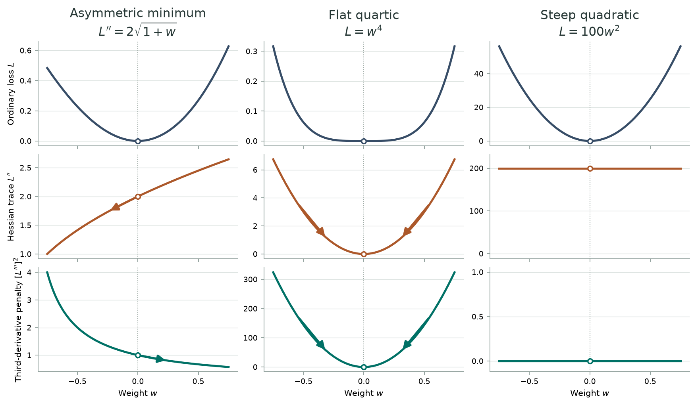
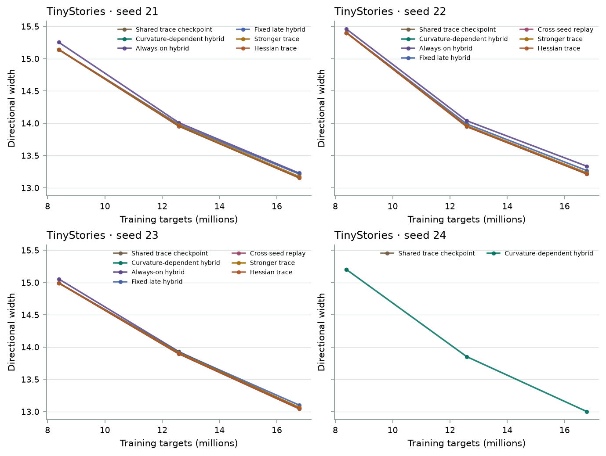
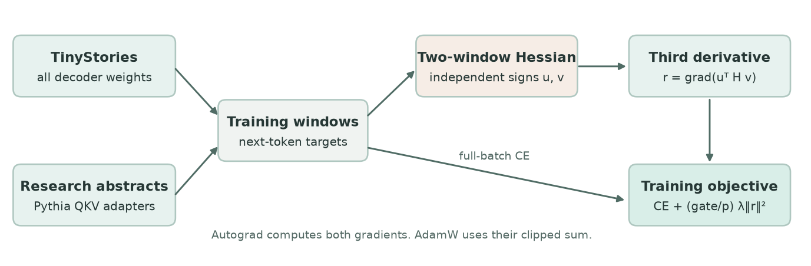
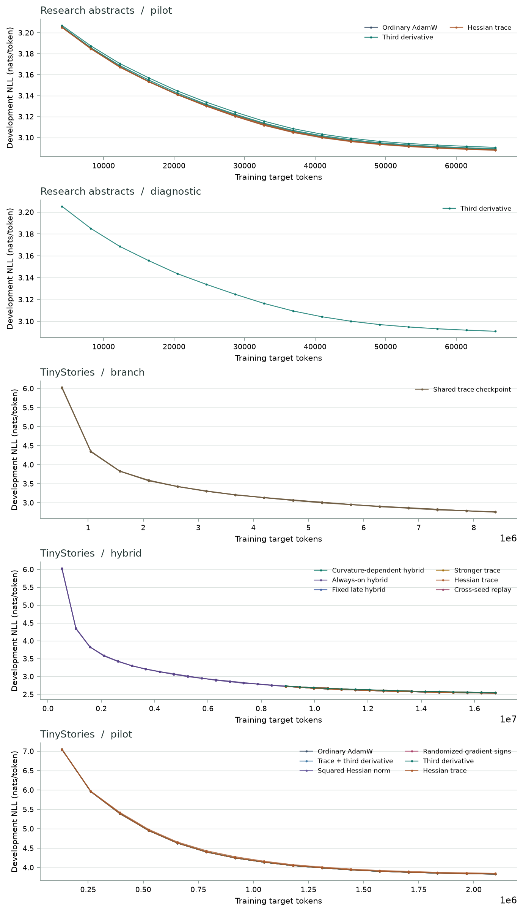

# Third derivatives in language-model training

Does a language model predict unseen tokens better when training penalizes rapid changes in loss curvature? We test this on a TinyStories decoder trained from scratch and on Pythia-410M attention adapters. A second TinyStories experiment compares a fixed late start with a schedule that increases the penalty as measured curvature falls. [Study design](reports/planned-runs.md)

The research background includes flat minima, Hessian measurements and third derivatives in language modeling and other fields. [Original flat-minima paper](https://people.idsia.ch/~juergen/fm/node1.html) · [Hessian regularization in GPT-2](https://arxiv.org/pdf/2306.08553#page=12) · [Hessians in image classification](https://arxiv.org/pdf/2012.03801) · [Third derivatives in language-model training dynamics](https://arxiv.org/pdf/2505.22042) · [Derivative penalties in splines](https://doi.org/10.1007/BFb0086566)

<!-- READOUT:START -->

## Results at a glance

**Lower next-token loss (NLL) is better** because the model assigns more probability to the tokens that actually came next. **Higher top-1 accuracy is better** because the model’s first guess is correct more often. Higher speed means more training targets per second. Lower peak memory uses fewer resources.

| Model and split | Matched evidence | Third-order NLL vs AdamW<br>↓ Lower is better | Third-order NLL vs trace<br>↓ Lower is better | Speed vs AdamW<br>↑ Higher is better |
| --- | --- | --- | --- | --- |
| TinyStories pretraining · dev | one development pilot seed | 0.000045 lower | 0.000338 lower | 65.7% slower |
| Pythia-410M adapters · dev | one development pilot seed | 0.000300 higher | 0.000273 higher | 88.6% slower |

**Adaptive vs fixed-ramp hybrid** · 3/8 paired seeds. Adaptive development NLL was 0.000204 lower. It retained 0.0542 less directional width after the switch. Median final widths were 13.157 (adaptive) and 13.215 (fixed). More width is better for the registered geometry test. Whether more width improves prediction is unknown.

Both primary test decisions are pending. Each stage requires eight paired test seeds and superiority over both baselines under Holm correction.

[Side-by-side scores, accuracy, speed and memory](#side-by-side-comparisons) · [Flatness by variant and baseline](#all-variants-and-baselines) · [Live explorer](https://huggingface.co/spaces/BurnyCoder/thirdloss-explorer) · [Paired tests and intervals](reports/summary.md)

<!-- READOUT:END -->

Sepp Hochreiter and Jürgen Schmidhuber proposed that **among models that fit the training data equally well, those in flatter minima may generalize better to unseen data**. In a flat minimum, many nearby weight settings still fit. If some weights can be rounded more coarsely without spoiling the fit, a good predictor can take fewer bits to describe under a fixed encoding. Their minimum-description-length argument links that shorter description to a lower risk of overfitting. [Hochreiter and Schmidhuber, *Flat Minima* (1997), §1](https://people.idsia.ch/~juergen/fm/node1.html)

**Why did earlier papers use the Hessian?** At a smooth minimum the gradient is zero, whether the valley is sharp or flat. The Hessian gives a quadratic approximation to how much training loss rises when the weights move. For small steps of equal size in uniformly random directions, the predicted average rise is proportional to the **Hessian trace**, the sum of second derivatives along the weight coordinates. The researchers penalized the trace to favor fits that tolerate small weight changes and tested whether those fits generalize better. [Liu, Yu and Lin, §§3.2–3.3](https://arxiv.org/pdf/2208.05924#page=3) · [Zhang, Li and Ju, equation 4](https://arxiv.org/pdf/2306.08553#page=5)

Sankar et al. observed that layerwise traces fell during image-classifier training and tried penalizing them directly. Liu, Yu and Lin drew on a generalization bound for linear classifiers to motivate a stochastic trace penalty and reported WikiText-2 experiments with LSTMs and GRUs. Zhang, Li and Ju paired opposite weight perturbations so the first-order loss changes would cancel, giving them a way to target curvature during GPT-2 fine-tuning for question answering. [Sankar et al., Figure 5 and Table 1](https://arxiv.org/pdf/2012.03801#page=6) · [Liu, Yu and Lin, §5.2](https://arxiv.org/pdf/2208.05924#page=10) · [Zhang, Li and Ju, Table 5](https://arxiv.org/pdf/2306.08553#page=12)

**Why third derivatives?** Two minima can have the same small curvature at the bottom, yet one can steepen much sooner. The third derivatives of next-token loss measure how its Hessian changes as the weights move. The training penalty estimates their sum of squares, so rapid changes of either sign carry a cost. If curvature starts small and changes slowly throughout a neighborhood, the weights can move farther while loss stays low. [Worked examples and width bound](docs/third-derivative-penalty.md#when-can-the-penalty-favor-a-wider-minimum) · [Taylor remainder, equation 22](https://link.springer.com/article/10.1007/s10288-023-00541-9)

**Why add the third-derivative penalty late?** Even a steep valley can have constant curvature. The registered TinyStories follow-up first trains with the Hessian-trace penalty to favor low average curvature. Its fixed-ramp arm keeps the trace active and gradually adds the third-derivative penalty after the midpoint. If curvature changes faster toward the edge of a flat region, the penalty can increase outward and oppose that movement. Delaying it also avoids early fourth-derivative computations. If the schedule preserves a wider region, its final weights should tolerate larger perturbations than the trace controls at the same allowed increase in unregularized loss. [Timing controls and width measurement](reports/hybrid/preregistration.md) · [Measured widths](reports/hybrid/results.md)

**Should the penalty get stronger as curvature falls?** The TinyStories follow-up keeps the trace active and turns up the **weight on the squared third derivatives** once training loss is low and recent Hessian measurements are small. It retains the highest weight reached, up to a cap. Eight paired seeds compare this rule with a fixed late ramp, another seed’s schedule, trace alone, stronger trace and an always-on hybrid. The endpoints are directional width on fixed training windows and development next-token loss. Direct division can act in the opposite direction. For $L(w)=w^4$, the squared ratio $(L'''/L'')^2=4/w^2$ grows without bound as weights approach the flat bottom. [Derivation](docs/third-derivative-penalty.md#weighting-the-penalty-by-curvature) · [Hybrid preregistration and run matrix](reports/hybrid/preregistration.md)

## Can the penalty favor a wider minimum?

A minimum is **wide** if the weights can move a long way before the loss rises by a chosen amount. [Basin width, Definition 1](https://proceedings.mlr.press/v70/dinh17b/dinh17b.pdf#page=2)

The penalty can help weights **stay** near a flat bottom. For $L(w)=w^4$, nudging the weight to either side makes the penalty rise, so a small descent step pulls it back. A steep quadratic such as $L(w)=100w^2$ has constant curvature and receives zero third-derivative penalty everywhere. [Worked examples](docs/third-derivative-penalty.md#when-can-the-penalty-favor-a-wider-minimum)

In the language models, an active update measures curvature change for the next-token cross-entropy of **two text windows**, with respect to all decoder weights for TinyStories or only the adapter weights for Pythia. Differentiating this penalty gives AdamW a fourth-derivative contribution. The primary comparison tests prediction on held-out tokens at equal training-token counts. The hybrid follow-up measures changes in directional width in fixed weight coordinates, since rescaling weights can change measured sharpness while preserving predictions. [Training update](docs/third-derivative-penalty.md#the-actual-training-update) · [Primary preregistration](reports/preregistration.md) · [Hybrid preregistration](reports/hybrid/preregistration.md) · [Dinh et al.](https://proceedings.mlr.press/v70/dinh17b.html)



*Analytic examples. The circles mark the ordinary loss minima. Arrows show downhill directions for the two penalties. Each panel has its own vertical scale.*

## Flat minima, Hessians and third derivatives in earlier work

| Setting | What the researchers used the derivatives for | Original papers and projects |
|---|---|---|
| Origin of flat-minimum search | Hochreiter and Schmidhuber searched for connected regions of weights where training error changes little. Their flatness penalty depends on the sensitivity of network outputs to the weights. Differentiating that penalty uses second derivatives of the outputs. | [Original NeurIPS paper, 1994](https://proceedings.neurips.cc/paper/1994/hash/01882513d5fa7c329e940dda99b12147-Abstract.html) · [Flat Minima (1997), equations 1–2](https://people.idsia.ch/~juergen/fm/node3.html) |
| Hessian penalties in language models | Zhang, Li and Ju approximate a Hessian-trace penalty with symmetric weight perturbations when fine-tuning GPT-2 on CommonsenseQA and StrategyQA. Liu, Yu and Lin propose a signed trace objective and report WikiText-2 LSTM and GRU experiments. | [GPT-2 experiments, Table 5](https://arxiv.org/pdf/2306.08553#page=12) · [Noise stability optimization code](https://github.com/VirtuosoResearch/Noise-stability-optimization) · [Recurrent LM penalty, §5.2](https://arxiv.org/pdf/2208.05924) |
| Other uses of Hessians in LLMs | Sophia uses stochastic curvature estimates to precondition GPT training updates. Liu et al. measure Hessian trace and study the downstream behavior of pretrained language models. | [Sophia paper](https://arxiv.org/pdf/2305.14342) · [Sophia code](https://github.com/Liuhong99/Sophia) · [Language-model flatness study](https://proceedings.mlr.press/v202/liu23ao.html) |
| Hessians outside language modeling | Layerwise Hessian-trace penalties have been tested in image classification. Reparameterization studies explain why a curvature measurement alone cannot establish predictive generalization. | [Sankar et al.](https://arxiv.org/pdf/2012.03801) · [Dinh et al.](https://proceedings.mlr.press/v70/dinh17b.html) |
| Third derivatives in language models | Yang et al. approximate third derivatives of the **training loss with respect to weights** to predict what happens when training batches are reordered. McGee et al. fit a cubic along a fine-tuning update to select a step size. Zhang and Wang test cubic corrections along hidden-activation interventions in a frozen model and report failures for large perturbations. | [FUT++, §5.1 and Appendix A.1](https://arxiv.org/pdf/2505.22042) · [Step selection, Appendix C.1.1](https://arxiv.org/pdf/2610.02190#page=28) · [Activation patching, §4 and supplement](https://arxiv.org/pdf/2606.09899) |
| Third derivatives outside LLMs | Wolinski projects third derivatives of the **weight-space loss** to regularize a local optimization model. Lellmann et al. study third **spatial** derivatives of terrain surfaces. Duchon gives the general squared-derivative roughness formulation. | [Projected parameter derivatives](https://arxiv.org/pdf/2312.03885) · [Third-order terrain reconstruction](https://www.lellmann.net/work/_media/lellmann_ssvm13.pdf) · [Spline roughness](https://doi.org/10.1007/BFb0086566) |
| Third derivatives in image classifiers | Grad-CAM++ uses diagonal third derivatives of a class score with respect to convolutional feature activations to locate image regions that contribute to a prediction. | [Chattopadhyay et al., equation 10](https://arxiv.org/pdf/1710.11063#page=4) · [Authors’ implementation](https://github.com/adityac94/Grad_CAM_plus_plus) |

Two independent random sign vectors estimate the squared Frobenius norm of the minibatch third derivative, including mixed partials between different weights. [Estimator derivation](docs/third-derivative-penalty.md#why-two-independent-sign-vectors-work-for-any-smooth-loss) · [Duchon](https://doi.org/10.1007/BFb0086566) · [Bujanović and Kressner](https://arxiv.org/pdf/2004.06433)

The protocol and run matrix were published before model execution. The scores, comparisons and continuations below are regenerated from each run’s raw records. [Preregistration](reports/preregistration.md) · [Run matrix](reports/planned-runs.md) · [Literature](reports/literature-review.md) · [State of the art](reports/state-of-the-art-review.md) · [Progress](reports/progress.md)

A same-probe check on pretrained Pythia found that single-precision arithmetic materially changed the third-order training gradient. The first adapter pilot is archived as a numerical diagnostic. The corrected adapter arms evaluate derivatives in double precision while ordinary training and prediction use the GPU. [Pre-test precision amendment](reports/amendments/adapter-precision.md) · [Full-model numerical checks](results/verification)

<!-- RESULTS:START -->

## Side-by-side comparisons

Each row states which direction is better for that metric. Bold highlights the best observed value at the displayed precision. A tie means the paired difference rounds to zero. NLL is negative log-likelihood in nats per target. Accuracy differences use percentage points (pp).

### TinyStories pretraining

**Full development split · one development pilot seed · 2,097,152 training targets per run.** Method columns show medians over the same seeds. The two right columns give the median paired change for third order against each baseline. The pilot also selected the derivative strengths. [Strength selection](results/selection/stories.json) · [Experiment ledger](reports/experiments/experiments.md)

| Metric | AdamW | Hessian trace | Third order | vs AdamW | vs Hessian trace |
| --- | --- | --- | --- | --- | --- |
| Development NLL<br>↓ Lower is better | 3.876976 | 3.877269 | **3.876931** | 0.000045 lower | 0.000338 lower |
| Dev top-1 accuracy<br>↑ Higher is better | **32.337%** | 32.329% | 32.326% | 0.011 pp lower | 0.003 pp lower |
| Equal-time probe NLL<br>↓ Lower is better | **3.82905** | 4.04765 | 4.95277 | 1.12372 higher | 0.90512 higher |
| Training speed (targets/s)<br>↑ Higher is better | **123,871** | 73,185 | 42,481 | 65.7% slower | 42.0% slower |
| Peak GPU allocation (MiB)<br>↓ Lower is better | 608.2 | 608.2 | 608.2 | Tie | Tie |

These early TinyStories pilots share the initialization seed and identical first-update token count, loss, accuracy and gradient norm. Initial weight digests were first recorded in later runs. [First-update records](reports/experiments/experiments.md)

The common training-time cutoff had a median of 16.9 seconds. The furthest checkpoint used for this row was 2.3 seconds before its cutoff.

Awaiting paired test results (0 of 8 full-horizon training triplets).

### Pythia-410M adapters

**Full development split · one development pilot seed · 65,536 training targets per run.** Method columns show medians over the same seeds. The two right columns give the median paired change for third order against each baseline. The pilot also selected the derivative strengths. [Strength selection](results/selection/abstracts.json) · [Experiment ledger](reports/experiments/experiments.md)

| Metric | AdamW | Hessian trace | Third order | vs AdamW | vs Hessian trace |
| --- | --- | --- | --- | --- | --- |
| Development NLL<br>↓ Lower is better | **3.113948** | 3.113974 | 3.114247 | 0.000300 higher | 0.000273 higher |
| Dev top-1 accuracy<br>↑ Higher is better | **41.321%** | **41.321%** | 41.315% | 0.006 pp lower | 0.006 pp lower |
| Training speed (targets/s)<br>↑ Higher is better | **1,659** | 435 | 189 | 88.6% slower | 56.5% slower |
| Peak GPU allocation (MiB)<br>↓ Lower is better | 2,346.3 | 2,346.3 | 2,346.3 | Tie | Tie |

An equal-time NLL comparison is pending because at least one arm lacks a recorded development checkpoint at or before the shared cutoff.

Peak host memory (lower uses less RAM) was AdamW 3.78 GiB, Hessian trace 10.28 GiB, Third order 13.09 GiB. This measure includes earlier work in each interpreter.

Awaiting paired test results (0 of 8 full-horizon training triplets).

The equal-time row uses the last available fixed-window development score at or before the fastest run’s finish time in each seed. Full-split NLL uses every development target. Training speed includes regularizer probes. Adapter derivatives use CPU float64 with one GPU reserved. [Timing definitions and checkpoint lags](reports/summary.md)

### Flatness of the trained checkpoints

How far can the weights move before next-token loss rises by 0.1 nats on eight fixed training windows? We add the crossing distances on both sides of each of 16 unit directions, then take their median. **Wider is flatter** in these coordinates. Establishing a local minimum would also require a stationarity test. [Flat-minima paper](https://people.idsia.ch/~juergen/fm/node1.html) · [Coordinate dependence](https://proceedings.mlr.press/v70/dinh17b/dinh17b.pdf#page=2)

**TinyStories hybrids** · Each row names the completed seeds. Switch and final widths are medians over those seeds. The final seed range shows the smallest and largest seed widths. The middle 50% column gives the medians of the within-seed directional quartiles. Spread has no preferred direction. A ray at the search limit supplies a lower bound.

| Hybrid arm | Seeds | Switch width<br>↑ Wider is flatter | Final width<br>↑ Wider is flatter | Final seed range | Middle 50% of final directions | Rays at limit / tested |
| --- | --- | --- | --- | --- | --- | --- |
| Curvature-dependent hybrid | 21, 22, 23, 24 | 15.172 | 13.103 | 13.001–13.215 | 12.933–13.331 | 0/128 |
| Fixed late hybrid | 21, 22, 23 | 15.143 | 13.215 | 13.103–13.268 | 13.036–13.411 | 0/96 |
| Hessian trace | 21, 22, 23 | 15.143 | 13.154 | 13.046–13.215 | 12.984–13.366 | 0/96 |
| Stronger trace | 21, 22, 23 | 15.143 | 13.175 | 13.069–13.233 | 13.002–13.387 | 0/96 |
| Cross-seed replay | 22, 23 | 15.198 | 13.133 | 13.047–13.218 | 12.933–13.431 | 0/64 |
| Always-on hybrid | 21, 22, 23 | 15.256 | 13.229 | 13.060–13.334 | 13.085–13.390 | 0/96 |

#### All variants and baselines

Each row uses the same fixed training windows and probe directions within its stage. Parentheses give measured / planned seeds for that cell. Targets count next-token examples used for optimizer updates in this study. The unigram uses counts from the full training split, and initial Pythia retains its pretrained backbone. Compare rows with matching targets and seeds. Larger **weight width** means greater tolerance to moving the model’s trainable parameters. Larger **common score width** means that all token scores can tolerate a larger shared bias before NLL rises by 0.1 nats, measured in RMS logit units. The unigram has zero trainable model weights and shares the score test with every neural predictor. Small differences can fall inside the numerical search brackets. Both widths have an unknown relationship to better held-out prediction. [Per-run search brackets](reports/flatness.md#per-run-checkpoint-measurements) · [All-model measurement design](reports/amendments/all-model-flatness.md)

**TinyStories · all model weights**

| Variant | Training targets | Seed cohort | Weight width<br>↑ Wider is flatter | RMS weight curvature<br>↓ Less local bending | Common score width<br>↑ More score tolerance |
| --- | --- | --- | --- | --- | --- |
| Initial checkpoint | 0 | 0 | 90.633 (1/1) | 0.43979 (1/1) | 0.9214 (1/1) |
| Unigram | 0 | 0 | N/A · no weights | N/A · no weights | 0.9152 (1/1) |
| Ordinary AdamW | 2,097,152 | 0 | 15.579 (1/1) | 0.45329 (1/1) | 0.9891 (1/1) |
| Hessian trace (1%) | 2,097,152 | 0 | 15.686 (1/1) | 0.44772 (1/1) | 0.9891 (1/1) |
| Third derivative (1%) | 2,097,152 | 0 | 15.640 (1/1) | 0.44739 (1/1) | 0.9891 (1/1) |
| Squared Hessian norm (3%) | 2,097,152 | 0 | 15.901 (1/1) | 0.42958 (1/1) | 0.9890 (1/1) |
| Randomized gradient signs (1%) | 2,097,152 | 0 | 15.571 (1/1) | 0.4536 (1/1) | 0.9892 (1/1) |
| Trace + third derivative (1%) | 2,097,152 | 0 | 15.741 (1/1) | 0.44132 (1/1) | 0.9891 (1/1) |
| Ordinary AdamW · confirmation | 16,777,216 | 1–8 | Pending | Pending | Pending |
| Hessian trace · confirmation | 16,777,216 | 1–8 | Pending | Pending | Pending |
| Third derivative · confirmation | 16,777,216 | 1–8 | Pending | Pending | Pending |
| Shared trace checkpoint | 8,388,608 | 21–28 | 15.172 (4/8) | 0.44445 (4/8) | 1.0618 (4/8) |
| Curvature-dependent hybrid · hybrid study | 16,777,216 | 21–28 | 13.103 (4/8) | 0.585 (3/8) | 1.0825 (3/8) |
| Fixed late hybrid · hybrid study | 16,777,216 | 21–28 | 13.215 (3/8) | 0.5776 (3/8) | 1.0823 (3/8) |
| Hessian trace · hybrid study | 16,777,216 | 21–28 | 13.154 (3/8) | 0.5854 (3/8) | 1.0825 (3/8) |
| Stronger trace · hybrid study | 16,777,216 | 21–28 | 13.175 (3/8) | 0.58362 (3/8) | 1.0826 (3/8) |
| Cross-seed replay · hybrid study | 16,777,216 | 21–28 | 13.133 (2/8) | 0.5891 (2/8) | 1.0824 (2/8) |
| Always-on hybrid · hybrid study | 16,777,216 | 21–28 | 13.229 (3/8) | 0.57089 (3/8) | 1.0821 (3/8) |

<details><summary>TinyStories · all model weights · other pilot strengths and precision diagnostics</summary>

| Variant | Training targets | Seed cohort | Weight width<br>↑ Wider is flatter | RMS weight curvature<br>↓ Less local bending | Common score width<br>↑ More score tolerance |
| --- | --- | --- | --- | --- | --- |
| Hessian trace (3%) | 2,097,152 | 0 | 15.898 (1/1) | 0.43612 (1/1) | 0.9889 (1/1) |
| Hessian trace (10%) | 2,097,152 | 0 | 16.444 (1/1) | 0.41261 (1/1) | 0.9878 (1/1) |
| Third derivative (3%) | 2,097,152 | 0 | 15.777 (1/1) | 0.43692 (1/1) | 0.9891 (1/1) |
| Third derivative (10%) | 2,097,152 | 0 | 16.219 (1/1) | 0.41607 (1/1) | 0.9884 (1/1) |

</details>

**Pythia-410M · adapter weights**

| Variant | Training targets | Seed cohort | Weight width<br>↑ Wider is flatter | RMS weight curvature<br>↓ Less local bending | Common score width<br>↑ More score tolerance |
| --- | --- | --- | --- | --- | --- |
| Initial checkpoint | 0 | 0 | 21.890 (1/1) | 0.69058 (1/1) | 1.0859 (1/1) |
| Unigram | 0 | 0 | N/A · no weights | N/A · no weights | 0.9150 (1/1) |
| Ordinary AdamW | 65,536 | 0 | 19.784 (1/1) | 1.2868 (1/1) | 1.0930 (1/1) |
| Hessian trace (1%) | 65,536 | 0 | 19.751 (1/1) | 1.1818 (1/1) | 1.0929 (1/1) |
| Third derivative (1%) | 65,536 | 0 | 19.922 (1/1) | 0.58227 (1/1) | 1.0928 (1/1) |
| Squared Hessian norm (3%) | 65,536 | 0 | Pending | Pending | Pending |
| Randomized gradient signs (1%) | 65,536 | 0 | Pending | Pending | Pending |
| Trace + third derivative (1%) | 65,536 | 0 | Pending | Pending | Pending |
| Ordinary AdamW · confirmation | 524,288 | 1–8 | Pending | Pending | Pending |
| Hessian trace · confirmation | 524,288 | 1–8 | Pending | Pending | Pending |
| Third derivative · confirmation | 524,288 | 1–8 | Pending | Pending | Pending |

<details><summary>Pythia-410M · adapter weights · other pilot strengths and precision diagnostics</summary>

| Variant | Training targets | Seed cohort | Weight width<br>↑ Wider is flatter | RMS weight curvature<br>↓ Less local bending | Common score width<br>↑ More score tolerance |
| --- | --- | --- | --- | --- | --- |
| Hessian trace (3%) | 65,536 | 0 | 19.775 (1/1) | 0.58335 (1/1) | 1.0929 (1/1) |
| Hessian trace (10%) | 65,536 | 0 | 19.856 (1/1) | 0.77214 (1/1) | 1.0930 (1/1) |
| Third derivative (3%) | 65,536 | 0 | 19.968 (1/1) | 0.56999 (1/1) | 1.0927 (1/1) |
| Third derivative (10%) | 65,536 | 0 | 19.997 (1/1) | 0.56095 (1/1) | 1.0926 (1/1) |
| Third derivative (3%) · excluded precision diagnostic | 65,536 | 0 | 19.885 (1/1) | 0.58797 (1/1) | 1.0932 (1/1) |

</details>

**TinyStories pretraining · development pilots · seeds 0 · 2,097,152 training targets**

| Flatness statistic | AdamW | Hessian trace | Third order |
| --- | --- | --- | --- |
| Directional width<br>↑ Wider is flatter | 15.579 | 15.686 | 15.640 |
| Final width range across seeds<br>Descriptive spread | One seed | One seed | One seed |
| Middle 50% of directions<br>Descriptive spread | 15.297–16.037 | 15.431–16.102 | 15.382–16.118 |
| Rays at limit / tested<br>Measurement coverage | 0/32 | 0/32 | 0/32 |
| Unperturbed probe NLL<br>↓ Lower fits these windows better | 3.84335 | 3.84501 | 3.84377 |
| RMS Hessian curvature<br>↓ Lower means less local bending | 0.453288 | 0.447721 | 0.447394 |
| Signed Hessian trace / parameter<br>No general better direction | +0.0036281 | +0.00356145 | +0.00357761 |

**Pythia-410M adapters · development pilots · seeds 0 · 65,536 training targets**

| Flatness statistic | AdamW | Hessian trace | Third order |
| --- | --- | --- | --- |
| Directional width<br>↑ Wider is flatter | 19.784 | 19.751 | 19.922 |
| Final width range across seeds<br>Descriptive spread | One seed | One seed | One seed |
| Middle 50% of directions<br>Descriptive spread | 19.185–20.320 | 19.179–20.260 | 19.400–20.421 |
| Rays at limit / tested<br>Measurement coverage | 0/32 | 0/32 | 0/32 |
| Unperturbed probe NLL<br>↓ Lower fits these windows better | 2.91035 | 2.91018 | 2.91090 |
| RMS Hessian curvature<br>↓ Lower means less local bending | 1.28684 | 1.18181 | 0.582266 |
| Signed Hessian trace / parameter<br>No general better direction | +0.00312322 | +0.00404879 | +0.00146738 |

For the primary comparison, TinyStories uses all weights and Pythia uses the LoRA factors. Compare widths within each model. The link gives every run, directional bracket and Hessian probe. [Flatness statistics and raw files](reports/flatness.md) · [Secondary measurement design](reports/amendments/checkpoint-flatness.md)

### TinyStories hybrid schedules

**Adaptive vs fixed ramp · 3/8 paired seeds · 16,777,216 targets per run.** Both arms resume the same trace-trained checkpoint. Width change is final width minus width at the switch. A larger change means more width retained at the fixed loss tolerance. For two negative changes, the one closer to zero lost less width.

| Metric | Adaptive | Fixed ramp | vs Fixed ramp |
| --- | --- | --- | --- |
| Development NLL<br>↓ Lower is better | **2.545908** | 2.546113 | 0.000204 lower |
| Dev top-1 accuracy<br>↑ Higher is better | 46.256% | **46.258%** | 0.001 pp lower |
| Width change after switch<br>↑ More retained is better for the width test | -1.9854 | **-1.9272** | 0.0542 less retained |
| Training speed (targets/s)<br>↑ Higher is better | 37,992 | **40,662** | 3.9% slower |
| Peak GPU allocation (MiB)<br>↓ Lower is better | 617.3 | 617.3 | Tie |

The remaining controls are paired independently. Each row uses only seeds that finished both arms. The always-on arm has its own measured width at the switch.

| Adaptive versus | Paired seeds | Adaptive NLL<br>↓ Lower is better | Adaptive width change<br>↑ More retained is better for the width test | Adaptive speed<br>↑ Higher is better |
| --- | --- | --- | --- | --- |
| Cross-seed replay | 2/8 | 0.000001 higher | 0.0010 less retained | 5.4% faster |
| Hessian trace | 3/8 | 0.000004 higher | 0.0020 more retained | 36.3% slower |
| Stronger trace | 3/8 | 0.000094 lower | 0.0181 less retained | 37.0% slower |
| Always-on hybrid | 3/8 | 0.000015 lower | 0.0417 more retained | 44.2% faster |

**Registered width decision** · Awaiting eight paired width measurements. Width probes use fixed training windows. [Every width, training-fit flag, replay and paired difference](reports/hybrid/results.md)

**Training diagnostics have no established better direction for held-out prediction.** A smaller derivative penalty meets its training objective more closely. The raw Hessian trace, third-derivative estimate, gradient norm and penalty strength describe the training process. Their predictive value is assessed separately by held-out NLL. [Objectives and endpoints](reports/preregistration.md)

<details><summary>Squared-Hessian, scrambled-gradient, combined and untrained controls</summary>

**TinyStories pretraining** · Pilot seed, 2,097,152 training targets.

| Metric | Third order | Squared Hessian | Scrambled signs | Trace + third |
| --- | --- | --- | --- | --- |
| Development NLL<br>↓ Lower is better | **3.876931** | 3.878680 | 3.877253 | 3.877172 |
| Dev top-1 accuracy<br>↑ Higher is better | 32.326% | 32.299% | **32.331%** | 32.317% |
| Training speed (targets/s)<br>↑ Higher is better | 42,481 | **83,790** | 50,914 | 41,030 |
| Peak GPU allocation (MiB)<br>↓ Lower is better | **608.2** | **608.2** | 608.6 | 619.3 |

**Pythia-410M adapters** · Secondary pilot comparisons are pending.

**Zero-update references** · The unigram uses training-split frequencies. Initial Pythia uses its pretrained weights.

| Stage | Initial NLL<br>↓ Lower is better | Unigram NLL<br>↓ Lower is better | Initial accuracy<br>↑ Higher is better | Unigram accuracy<br>↑ Higher is better |
| --- | --- | --- | --- | --- |
| TinyStories pretraining | 8.343680 | 6.003555 | 0.312% | 7.151% |
| Pythia-410M adapters | 3.251674 | 7.330611 | 39.911% | 6.023% |

</details>

### Same-prompt continuations

Each panel shows the first saved prompt and full continuations from the lowest matched seed. These examples have no quality rating. The method names link to the raw generations.

<details><summary>TinyStories pretraining · same prompt, seed 0</summary>

**Prompt** <samp>Once upon a time, there was a clever little dog named Max. Max loved</samp>

| [AdamW](results/stories-pilot-s00-ce-r00/samples.jsonl) | [Hessian trace](results/stories-pilot-s00-trace-r01/samples.jsonl) | [Third order](results/stories-pilot-s00-third-r01/samples.jsonl) |
| --- | --- | --- |
| <samp> to play on the cat.</samp> | <samp> to play on the cat.</samp> | <samp> to play on the cat.</samp> |

</details>

<details><summary>Pythia-410M adapters · same prompt, seed 0</summary>

**Prompt** <samp>One of the central objectives of contemporary neuroimaging research is to<br>create predictive models</samp>

| [AdamW](results/abstracts-pilot-s00-ce-r00/samples.jsonl) | [Hessian trace](results/abstracts-pilot-s00-trace-r01-fp64/samples.jsonl) | [Third order](results/abstracts-pilot-s00-third-r01-fp64/samples.jsonl) |
| --- | --- | --- |
| <samp> that will accurately predict the behavior of<br>patient-specific neurological disorders such as epilepsy. In this paper, we<br>present a novel dataset of EEG data recorded from children with focal<br>subcortical epilepsy</samp> | <samp> that will be used to assess the cognitive<br>performance of neurological disorders. We will focus on three major areas:<br>(1) the nervous system as a whole, (2) the brain regions that</samp> | <samp> that will accurately predict the behavior of<br>patient-specific neurological disorders such as epilepsy. In this paper, we<br>present a novel dataset of EEG data recorded from children with focal<br>subcortical epilepsy</samp> |

</details>

<details><summary>TinyStories hybrid schedules · same prompt, seed 21</summary>

**Prompt** <samp>Once upon a time, there was a clever little dog named Max. Max loved</samp>

| [Adaptive](results/stories-hybrid-s21-adaptive-r01/samples.jsonl) | [Fixed ramp](results/stories-hybrid-s21-late-r01/samples.jsonl) |
| --- | --- |
| <samp> to play on the swings and slide. His owner liked to run and play outside. Lily was happy to see his dog and play.<br><br>One day, Max found a big hole in his house</samp> | <samp> to play on the swings and slide. His owner liked to run and play outside. Lily was happy to see his dog and play.<br><br>One day, Max found a big hole in his mail</samp> |

</details>

[Explore the results](https://burnycoder.github.io/llm-training-with-penalizing-rapid-changes-of-curvature-of-its-loss-with-derivative-of-hessian/) · [Hugging Face explorer](https://huggingface.co/spaces/BurnyCoder/thirdloss-explorer) · [Hugging Face collection](https://huggingface.co/collections/BurnyCoder/third-derivatives-in-language-model-training-6b067fb7d5ae3eca49ebb378) · [Paper](reports/paper.pdf) · [Run ledger](reports/experiments/experiments.md)

Recorded 45 runs, including 44 with a completed summary.

TinyStories hybrid follow-up: 18 of 48 full runs and 4 of 8 shared checkpoints complete. Geometric decision: awaiting eight paired width measurements. [Width measurements, scores and controls](reports/hybrid/results.md)

[Full score table, strength search and per-seed test differences](reports/summary.md)







### Full generations by method

**TinyStories** · [Initial checkpoint](reports/experiments/stories-control-s00-initial-r00/experiment.md#fixed-prompt-generations) · [Unigram](reports/experiments/stories-control-s00-unigram-r00/experiment.md#fixed-prompt-generations) · [Curvature-dependent hybrid](reports/experiments/stories-hybrid-s21-adaptive-r01/experiment.md#fixed-prompt-generations) · [Always-on hybrid](reports/experiments/stories-hybrid-s21-always-r01/experiment.md#fixed-prompt-generations) · [Fixed late hybrid](reports/experiments/stories-hybrid-s21-late-r01/experiment.md#fixed-prompt-generations) · [Stronger trace](reports/experiments/stories-hybrid-s21-strong-r01/experiment.md#fixed-prompt-generations) · [Hessian trace](reports/experiments/stories-hybrid-s21-trace-r01/experiment.md#fixed-prompt-generations) · [Cross-seed replay](reports/experiments/stories-hybrid-s22-replay-r01/experiment.md#fixed-prompt-generations) · [Ordinary AdamW](reports/experiments/stories-pilot-s00-ce-r00/experiment.md#fixed-prompt-generations) · [Trace + third derivative](reports/experiments/stories-pilot-s00-combined-r01/experiment.md#fixed-prompt-generations) · [Squared Hessian norm](reports/experiments/stories-pilot-s00-hessian_norm-r03/experiment.md#fixed-prompt-generations) · [Randomized gradient signs](reports/experiments/stories-pilot-s00-sham-r01/experiment.md#fixed-prompt-generations) · [Third derivative](reports/experiments/stories-pilot-s00-third-r01/experiment.md#fixed-prompt-generations)

**Research abstracts** · [Initial checkpoint](reports/experiments/abstracts-control-s00-initial-r00/experiment.md#fixed-prompt-generations) · [Unigram](reports/experiments/abstracts-control-s00-unigram-r00/experiment.md#fixed-prompt-generations) · [Ordinary AdamW](reports/experiments/abstracts-pilot-s00-ce-r00/experiment.md#fixed-prompt-generations) · [Third derivative](reports/experiments/abstracts-pilot-s00-third-r01-fp64/experiment.md#fixed-prompt-generations) · [Hessian trace](reports/experiments/abstracts-pilot-s00-trace-r01-fp64/experiment.md#fixed-prompt-generations)

<!-- RESULTS:END -->

## Reproduce the study

Use Python 3.12, uv, and an NVIDIA GPU. From the repository root, install the locked environment, verify the derivatives and start the study.

```sh
uv sync --locked
uv run --locked thirdloss verify
uv run --locked thirdloss study --with-hybrid --with-flatness
```

This trains both model families, runs the six hybrid variants, evaluates the frozen models, and measures flatness for each checkpoint and reference. Repeating the study command resumes it. To measure existing saved models separately, run `uv run --locked thirdloss flatness --phase all`. In another terminal, `uv run --locked thirdloss dashboard --port 18765` serves live accuracy, loss and curvature. Regenerate the paper, plots and tables with `uv run --locked thirdloss report`. [Setup, checkpoint loading and publication](docs/runbook.md) · [Document splits](docs/data.md) · [Model collection](https://huggingface.co/collections/BurnyCoder/third-derivatives-in-language-model-training-6b067fb7d5ae3eca49ebb378)

The pipeline pins the source texts, splits by document, learns the stories tokenizer using training documents, and freezes the evaluation definition. Identical initializations and document orders pair the competing objectives. The smaller model trains all weights. The pretrained model trains only attention adapters. Examine both improvement and deterioration across seeds and both computational budgets. [TinyStories](https://arxiv.org/pdf/2305.07759) · [Pythia](https://huggingface.co/EleutherAI/pythia-410m) · [Common Pile](https://huggingface.co/datasets/common-pile/arxiv_abstracts_filtered) · [LoRA](https://arxiv.org/pdf/2106.09685)

## Milestones

- Publish the protocol, references and analysis decisions.
- Verify the scalar objective and its training gradient on analytical functions and a small Transformer.
- Train the pilot, publish throughput and establish feasibility on the local GPU.
- Complete controls, development selection, paired confirmations and a reproducible report.
- [ ] Test whether adding the third-derivative penalty late in Hessian-trace training helps the model stay in a wider low-loss region. [Exploratory plan and rationale](reports/plan.md#late-third-derivative-regularization)
- [ ] Compare a capped third-derivative penalty weight that rises as measured curvature falls with the fixed-token schedule. Test whether it preserves directional width at comparable training fit and whether it improves held-out token prediction. [Curvature-dependent schedule and controls](reports/plan.md#curvature-dependent-penalty-weight)
