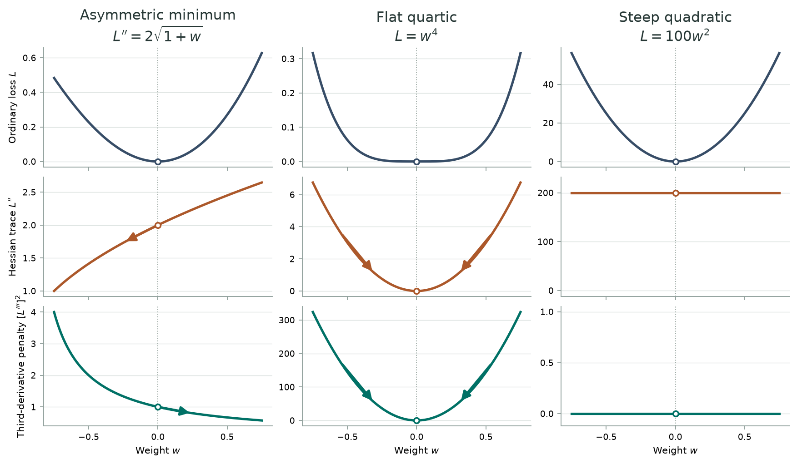

# How the project computes the third-derivative penalty

The model assigns a probability to each possible next token. Its **loss** is the mean negative log probability it assigns to the tokens that actually follow. The project differentiates this number **with respect to the trainable weights**. The first derivative gives the slope of the loss, the second gives its curvature, and the third tells us how that curvature changes as a weight moves. The training penalty adds up the **squares** of those changes. [Token loss](../src/thirdloss/models.py) · [Preregistered objective](../reports/preregistration.md)

## Why might a flat minimum generalize better?

Hochreiter and Schmidhuber compared solutions that fit the training examples about equally well. They searched for a wide box of acceptable weight settings around a solution. The tolerated range for each weight determines how many digits can be discarded while preserving the fit. Under their encoding, a larger box can give a shorter description of the network. Their hypothesis was that these simpler fits would, on average, overfit less. [Box construction](https://people.idsia.ch/~juergen/fm/node2.html) · [Description-length argument](https://people.idsia.ch/~juergen/fm/node5.html) · [Assumptions about generalization](https://people.idsia.ch/~juergen/fm/node16.html)

This project compares two local quantities. The Hessian trace sums the curvatures along the principal directions. The third derivative measures changes in the full Hessian, including changes that leave the trace constant. Dinh et al. showed that rescaling a ReLU network can change measured sharpness while preserving every prediction. For that reason the TinyStories follow-up measures perturbations in the same weight coordinates across runs. Wider measured directions with unchanged held-out token loss would show greater tolerance to those perturbations without evidence of better prediction. [Dinh et al., §4](https://proceedings.mlr.press/v70/dinh17b.pdf) · [Registered width measurements](../reports/hybrid/preregistration.md#endpoints-and-falsification)

## When can the penalty favor a wider minimum?

Think of moving one weight $w$ while holding the data fixed. Pick a tolerable loss increase $\epsilon$. The width of a minimum is the length of the interval around it where the loss stays within $\epsilon$ of its value at the bottom. In many dimensions one can measure this distance along a specified direction, or the volume of the connected low-loss region. Both depend on the weight coordinates and the chosen tolerance. [Dinh et al., Definition 1 and Figure 1](https://proceedings.mlr.press/v70/dinh17b/dinh17b.pdf#page=2)

For one weight and a positive coefficient $\lambda$, adding a penalty to the ordinary loss $\ell$ changes the gradient as follows. A small gradient-descent step moves opposite the gradient. At a minimum of $\ell$, the ordinary slope is zero, so the penalty can determine the initial direction.

| What the objective penalizes | Term added to the loss | Term added to its gradient |
|---|---|---|
| Hessian trace (curvature in one dimension) | $\lambda\ell''$ | $\lambda\ell'''$ |
| Squared third derivative (how quickly curvature changes) | $\lambda(\ell''')^2$ | $2\lambda\ell'''\ell''''$ |

With many weights, the trace adds the curvatures along the Hessian’s principal directions. Near a smooth minimum, a lower trace means a smaller average loss increase from small, isotropic weight perturbations to second order. The combined training arm adds the trace term and the squared third-derivative estimate with separately calibrated coefficients. The figure illustrates the signs for plain gradient descent. The model runs use sampled minibatches and probes, gradient clipping and AdamW. [Noise stability, equation 4](https://arxiv.org/pdf/2306.08553#page=5) · [Training update](#the-actual-training-update)

*The circles mark $w=0$, a minimum of each ordinary loss. Arrows give the direction of a decrease in each penalty. Their lengths are illustrative and the vertical scales differ. The report command draws these curves from their formulas.* [Figure source](../src/thirdloss/report_figures.py)

- **Opposite directions at the same minimum.** The first loss has $\ell(0)=\ell'(0)=0$ and $\ell''(w)=2\sqrt{1+w}$ for $w>-1$. Moving right increases curvature, and its rate of increase slows. The trace penalty therefore pushes left. The squared third derivative is $1/(1+w)$, which decreases to the right, so that penalty pushes right.
- **A pull back after a displacement.** For $\ell(w)=w^4$, curvature is $12w^2$ and the third derivative is $24w$. The unweighted penalty is $576w^2$. Its gradient $1152w$ vanishes at zero and gives a descent step toward zero from either side. This is a mechanism for staying near a flat bottom after a small perturbation. [Analytic gradient check](../tests/test_derivatives.py)
- **A sharp minimum with zero penalty.** For $\ell(w)=a w^2$ with $a>0$, curvature is the constant $2a$. Increasing $a$ makes the low-loss interval narrower at any fixed tolerance, yet every member of this family has zero third derivative everywhere. The trace assigns a larger cost to the steeper quadratic, though its own gradient within each quadratic is also zero.

### From a local penalty to basin width

Stretch the same loss horizontally without changing its depth, so $\ell_s(w)=\ell(w/s)$ for $s>1$. At a fixed loss increase the width grows by $s$. At corresponding points the curvature scales by $s^{-2}$ and the third derivative by $s^{-3}$. Thus a wider version of the same valley can score lower on the third-derivative penalty. Even here, $\ell(w)=w^4$ and $16w^4$ both have zero third derivative at the bottom, although the former is twice as wide at a given loss increase.

There is a sufficient condition for the loss to stay low over a displacement $r$. If the curvature at a smooth minimum $w_0$ is $h$ and $|\ell'''|\le M$ **throughout the interval** to $w_0+r$, Taylor’s theorem gives

$$
\ell(w_0+r)-\ell(w_0)\ \le\ \tfrac12 h r^2+\tfrac16 M|r|^3 .
$$

Small initial curvature and slowly changing curvature across the interval together limit the loss increase. The training code samples the third derivative of two-window cross-entropy at the **current weights**. For TinyStories these coordinates include the whole decoder. For research abstracts they include only the trainable low-rank attention factors of Pythia-410M. A width measurement would therefore need a fixed loss tolerance and perturbations in the corresponding stage’s trainable coordinates. The logged penalty estimates describe local curvature change. The preregistered test compares held-out next-token loss across matched seeds at equal training tokens. [Taylor remainder, equation 22](https://link.springer.com/article/10.1007/s10288-023-00541-9) · [Stage definitions](../reports/planned-runs.md) · [Preregistered comparison](../reports/preregistration.md)

### Weighting the penalty by curvature

The adaptive arm of the registered TinyStories follow-up keeps the Hessian-trace penalty active. Its hypothesis is that, after training has reached low loss and small curvature, it is worth penalizing rapid changes in that curvature more strongly. A small Hessian can also occur on a slope. For example, $L(w)=w$ has zero Hessian and unit gradient everywhere. The follow-up therefore records training loss and gradient norm and tests width by perturbing the weights. [Registered experiment](../reports/hybrid/preregistration.md)

Direct division changes the objective. For $L(w)=w^4$, the existing penalty is $(L''')^2=576w^2$. The squared relative change $(L'''/L'')^2=4/w^2$ for $w\ne0$ diverges toward the minimum and is undefined at zero. Descending that ratio pushes a displaced weight outward. In many dimensions $H$ is a matrix and $D H$ is a third-order tensor, so a ratio also requires a choice of norms or contraction. A positive floor prevents division by zero, but a differentiable denominator can still reward increasing the curvature magnitude. [Quartic gradient check](../tests/test_derivatives.py)

One testable rule uses the magnitude of the Hessian of unregularized training loss. For $d$ trainable coordinates and an independent random sign vector $v$, $\mathbb E_v\lVert Hv\rVert_2^2=\operatorname{tr}(H^\top H)=\lVert H\rVert_F^2$. This counts curvature of either sign and can be estimated with the project’s existing Hessian-vector probe. Let $c_t$ be the square root of the mean of $\lVert Hv\rVert_2^2/d$ over the last $m$ completed training-only probe measurements before update $t$. This measures typical curvature in fixed weight coordinates. A few sharp directions can coexist with a small average. [Hessian-norm estimator](../src/thirdloss/penalties.py) · [Trace identity](https://arxiv.org/pdf/2010.09649#page=2)

After a trace-only warm-up, once the prespecified training-loss criterion is met and the probe window is full, the adaptive arm updates the coefficient using

$$
\lambda_{3,t}=\max\!\left(\lambda_{3,t-1},\ \lambda_{\max}\max\!\left(0,1-\frac{c_t}{c_*}\right)\right).
$$

Start at zero, with fixed $c_*>0$ and $\lambda_{\max}>0$. Lower measured curvature can raise the weight up to $\lambda_{\max}$. Retaining the highest value reached keeps the penalty active if curvature rebounds. For the existing squared third-derivative estimate $\widehat P_3$, holding the coefficient fixed during differentiation gives $\nabla_\theta(\lambda_{3,t}\widehat P_3)=\lambda_{3,t}\nabla_\theta\widehat P_3$. The usual sampled-update scaling still applies. If the estimate increases toward the edge, this penalty gradient can oppose an outward step. [Study objective and gradient](#the-actual-training-update) · [Registered controls](../reports/hybrid/preregistration.md#run-matrix)

#### Worked example from curvature to training loss

Follow one weight through four hypothetical curvature measurements after warm-up, with the low-loss criterion already met. The paper writes $\lambda_t$ for the third-derivative coefficient $\lambda_{3,t}$ above. Its final appendix gives the two equations used here under **Curvature-dependent coefficient** and **Shared training objective**. [Current paper](../reports/paper.pdf) · [Equation appendix, p. 11 in the registered version](https://raw.githubusercontent.com/BurnyCoder/llm-training-with-penalizing-rapid-changes-of-curvature-of-its-loss-with-derivative-of-hessian/70f7d4bea0c8f092a4bc8eb6b1d3a36f2dbbb33c/reports/paper.pdf#page=11)

**1. Measure curvature before the update.** Let $d$ count the weights and let $S(t)$ contain the last $m$ completed measurements. At measurement $j$, $H_j$ is the Hessian and $z_j$ is its random sign probe. Take one weight and one past measurement ($d=m=1$) with $z=+1$. Then

$$
\begin{aligned}
c_t
&=\sqrt{\frac{1}{md}\sum_{j\in S(t)}\lVert H_jz_j\rVert_2^2}
 =\sqrt{\frac{1}{1\cdot1}(H\cdot1)^2}
 =\sqrt{H^2}=|H|.
\end{aligned}
$$

Suppose the four scalar Hessian measurements are $1.00,\ 0.50,\ 0.25,\ 0.75$. Each is positive, so each gives the same number for $c_t$. The TinyStories runs compute root-mean-square curvature from eight past measurements, fix $c_*$ at each seed’s trace-trained checkpoint and use a calibrated coefficient cap. [Registered curvature rule](../reports/hybrid/preregistration.md#curvature-rule) · [Schedule implementation](../src/thirdloss/hybrid.py)

**2. Carry the weight forward.** For this example set the threshold $c_*=1$, the cap $\lambda_{\max}=1$, and the initial weight $\lambda_0=0$. Substituting these into the rule gives

$$
\begin{aligned}
\lambda_t
&=\max\!\left(\lambda_{t-1},\,1\cdot\max(0,1-c_t/1)\right)\\
&=\max\!\left(\lambda_{t-1},\,\max(0,1-c_t)\right).
\end{aligned}
$$

| Update $t$ | Measured $c_t$ | Previous weight $\lambda_{t-1}$ | Candidate $\max(0,1-c_t)$ | Weight used $\lambda_t$ |
|---|---:|---:|---|---|
| 1 | 1.00 | 0 | $\max(0,1-1.00)=\max(0,0)=0$ | $\max(0,0)=0$ |
| 2 | 0.50 | 0 | $\max(0,1-0.50)=\max(0,0.50)=0.50$ | $\max(0,0.50)=0.50$ |
| 3 | 0.25 | 0.50 | $\max(0,1-0.25)=\max(0,0.75)=0.75$ | $\max(0.50,0.75)=0.75$ |
| 4 | 0.75 | 0.75 | $\max(0,1-0.75)=\max(0,0.25)=0.25$ | $\max(0.75,0.25)=0.75$ |

Between updates 2 and 3, curvature falls from $0.50$ to $0.25$ and the weight rises from $0.50$ to $0.75$. At update 4, curvature rebounds. The previous peak wins the outer maximum, so the penalty keeps its weight of $0.75$.

**3. Square the third derivative and apply the weight.** Consider two possible points $A$ and $B$ at update 4 with the same token loss $L$, the same sampled Hessian trace $h$ and the same coefficient history. Suppose curvature changes twice as fast at $B$, with scalar third derivatives $T_A=1$ and $T_B=2$. In one dimension the paper’s $P_3=\lVert T[u,v,\cdot]\rVert_2^2$ simplifies to $(Tuv)^2$. Take both sign probes to be $+1$. [Penalty estimator](../src/thirdloss/penalties.py)

$$
\begin{aligned}
P_{3,A}&=(1\cdot1\cdot1)^2=1,
&\lambda_4 P_{3,A}&=0.75\cdot1=0.75,\\
P_{3,B}&=(2\cdot1\cdot1)^2=4,
&\lambda_4 P_{3,B}&=0.75\cdot4=3.
\end{aligned}
$$

**4. Substitute into the full training objective.** The trace has coefficient $\alpha$. On an active update the gate is $I=1$ with sampling probability $p=1/8$, so $I/p=1/(1/8)=8$. The gate scales both penalty terms. [Training update](#the-actual-training-update)

$$
\begin{aligned}
J &= L+\frac{I}{p}\left[\alpha h+\lambda_4 P_3\right],\\
J_A &= L+8(\alpha h+0.75)=L+8\alpha h+6,\\
J_B &= L+8(\alpha h+3)=L+8\alpha h+24,\\
J_B-J_A &=(L+8\alpha h+24)-(L+8\alpha h+6)=24-6=18.
\end{aligned}
$$

The third-derivative contribution is four times as large at $B$ ($24/6=4$). If $B$ lies nearer the edge of a flat region, this difference favors the interior point $A$ at equal loss and curvature. The experiment tests that geometric hypothesis by perturbing the trained weights and measuring how far they can move before token loss rises. [Width measurements and comparison across training arms](../reports/hybrid/results.md)

## What gets differentiated?

Let $\theta=(\theta_1,\ldots,\theta_d)$ be the $d$ trainable numbers. Let $B$ be the fixed **minibatch**, the training examples whose mean loss is $\ell_B(\theta)$. Write $\partial_i$ for the rate of change as weight $\theta_i$ moves with all other weights held fixed.

With many weights you choose **which weight** to differentiate at each step. PyTorch applies the chain rule at the current weights along the chosen directions. The estimate enters when one pair of directions stands in for the sum of squares over all weight triples. [Penalty implementation](../src/thirdloss/penalties.py)

| Quantity | Meaning |
|---|---|
| $g_k=\partial_k\ell_B$ | The slope along weight $k$. The **gradient** $g=\nabla_\theta\ell_B$ lists these slopes for all weights. |
| $H_{jk}=\partial_j g_k$ | How the slope along $k$ changes when $j$ moves. The **Hessian** $H_B$ is the table of all such second derivatives. |
| $T_{ijk}=\partial_i H_{jk}$ | How that curvature changes when $i$ moves. The **third-derivative tensor** $T=\nabla_\theta^3\ell_B$ is the array of all ordered triples. |
| $P_B=\sum_{i,j,k}T_{ijk}^2$ | The **squared Frobenius norm**. Square each entry and add over all three indices to get one training penalty. |

A **pure** third derivative uses the same weight three times, as in $T_{xxx}$. A **mixed** derivative uses several weights, as in $T_{xxy}$. For a smooth loss, permuting these indices gives the same derivative value. Each ordered position still counts in the squared norm. Squaring lets increases and decreases both contribute. Two entries $+2$ and $-2$ would sum to zero, while their squares contribute $8$.

## A direct calculation beside an all-plus probe

Take two weights, $x=1$ and $y=2$. Set $s=x+y$ and $\ell(x,y)=s^3/3$. In the table, differentiate the expressions in $x,y$ before substituting the values. Both $\partial_xs$ and $\partial_ys$ equal $1$.

A **probe** is a vector used to take a weighted sum. Suppose the four independent sign draws for our two probes all happen to be $+1$. Then $u=v=(1,1)$ for this draw. Every weighted sum in the right column is ordinary addition.

| Step | Direct derivatives, entry by entry | One probe pair, adding along the way |
|---|---|---|
| First derivative | $\partial_x\ell=(3s^2/3)\cdot1=s^2$. Likewise $\partial_y\ell=s^2$. The gradient is $(s^2,s^2)=(9,9)$. | Start with the same gradient. Use $u$ to add its two entries, giving $a=s^2+s^2=2s^2$. |
| Second derivative | Each gradient entry has derivative $2s$ in $x$ and $2s$ in $y$. The Hessian has four entries, each $2s=6$. | Differentiate $a$ to get $(4s,4s)=(12,12)$. Use $v$ to add again, giving $b=4s+4s=8s$. |
| Third derivative | Differentiate each of those four Hessian entries in both $x$ and $y$. Each derivative is $2\cdot1=2$. There are eight entries equal to $2$. | Differentiate $b$ to get $r=(\partial_x(8s),\partial_y(8s))=(8,8)$. |
| Square and add | $8\times 2^2=\mathbf{32}$. | $8^2+8^2=\mathbf{128}$. |

**Where did the extra contribution come from?** For the $x$ component alone, the direct calculation gives $2^2+2^2+2^2+2^2=16$. The probe gives $(2+2+2+2)^2=64$. The same thing happens for $y$. For the **raw sum**, the two routes agree exactly because the eight entries sum to $16$ and $r_x+r_y=8+8=16$. Keeping just the **pure** entries would give a squared sum of $2^2+2^2=8$. The full squared norm includes six mixed entries as well.

**What happens with random signs?** For this Hessian, $u^\top H_Bv=2s(u_1+u_2)(v_1+v_2)$. If either vector has opposite entries, its sum is zero, so $r=(0,0)$. If the two entries within each vector match, both sums have magnitude $2$ and both entries of $r$ have magnitude $8$. Each vector has matching entries with probability $1/2$, independently of the other vector. Across the 16 equally likely probe pairs, 12 give $0$ and four give $128$. Their average is the exact $32$.

## Why two independent sign vectors work for any smooth loss

Draw each entry of $u$ and $v$ independently, equally likely to be $+1$ or $-1$. These are **Rademacher** signs, with no division by the vector length. Hold them fixed while differentiating. The transpose in $u^\top H_Bv$ turns $u$ into a row. A dot product multiplies matching entries and adds them. In the following expansion, multiplying $H_B$ by $v$ sums along each row, and dotting with $u$ sums across rows.

$$
(H_Bv)_j=\sum_k H_{jk} v_k,\qquad
u^\top H_Bv=\sum_j u_j(H_Bv)_j=\sum_{j,k}u_jv_k H_{jk}.
$$

Taking the gradient gives one number for each $i$. A derivative of a finite sum is the sum of its derivatives. The signs factor out as constants, so

$$
r_i=\partial_i(u^\top H_Bv)
=\sum_{j,k}u_jv_k\,\partial_i H_{jk}
=\sum_{j,k}u_jv_k\,T_{ijk}.
$$

This is the exact **contraction** for the chosen signs, meaning that two indices of the tensor have been summed and one is still free. The random estimate is the scalar $\widehat P_B=\lVert r\rVert_2^2=\sum_i r_i^2$, the squared **Euclidean length** of that vector.

Squaring one component multiplies its sum by a second copy. Label the indices in the second copy $a,b$ so we can see which entries get paired.

$$
r_i^2=
\left(\sum_{j,k}T_{ijk}u_jv_k\right)
\left(\sum_{a,b}T_{iab}u_av_b\right)
=\sum_{j,k,a,b}T_{ijk}T_{iab}\,u_j u_a v_k v_b.
$$

**Expectation** $\mathbb E$ means average over the signs at the same weights and on the same minibatch. If $j=a$, then $u_j u_a=1$. If $j\ne a$, the product is equally likely to be $+1$ or $-1$ and averages to zero. The same holds for $v_k v_b$. Independence between the vectors lets us multiply these two averages. Only $j=a$ **and** $k=b$ survive, giving

$$
\mathbb E_{u,v}[r_i^2]=\sum_{j,k}T_{ijk}^2,\qquad
\mathbb E_{u,v}[\widehat P_B]=\sum_i\mathbb E_{u,v}[r_i^2]
=\sum_{i,j,k}T_{ijk}^2=\lVert T\rVert_F^2 .
$$

One probe supplies signs for $j$, the other for $k$. The gradient already returns every $i$. The word **unbiased** refers to the equality after averaging. The example above shows how far a single draw can be from that average. The same identity follows from treating $(j,k)$ as a single column index in the matrix version of the result. [Bujanović and Kressner, Lemma 2.1](https://arxiv.org/pdf/2004.06433#page=3)

### What breaks if we reuse one vector?

Take $\ell(x,y)=x^2y/2$. Its gradient is $(xy,x^2/2)$, so its Hessian and the two slices of its third derivative are

$$
H=\begin{pmatrix}y&x\\x&0\end{pmatrix},\qquad
\partial_x H=\begin{pmatrix}0&1\\1&0\end{pmatrix},\qquad
\partial_y H=\begin{pmatrix}1&0\\0&0\end{pmatrix}.
$$

Both pure third derivatives are zero. The three ones come from mixed derivatives, so the exact penalty is $3$. Multiply the Hessian by the two probes to get $u^\top H v=y u_1v_1+x(u_1v_2+u_2v_1)$. Differentiating in $x,y$ gives $r=(u_1v_2+u_2v_1,\ u_1v_1)$.

| How the signs are drawn | What gets squared | Result |
|---|---|---|
| Independent $u,v$ | The two signs in $r_x$ reinforce half the time and cancel half the time. The square of $r_y$ is always $1$. | The estimate is $5$ or $1$ with equal probability. Its mean is $3$. |
| Set $v=u$ on every draw | $r_x=u_1u_2+u_2u_1=2u_1u_2$ and $r_y=u_1^2=1$. | Every draw gives $4+1=5$. Its mean is $5$. |

## Why the project computes a vector instead of listing every derivative

The ordinary training gradient already contains one exact automatic derivative per trainable coordinate, up to floating-point rounding. A third derivative has three coordinate slots. With $d$ weights the dense array has $d^3$ ordered entries. The counts below use the recorded trainable coordinates. The storage estimates count just one dense array at the arithmetic precision used by the corresponding derivative path. An exabyte (EB) is $10^{18}$ bytes. [Weight and loss definitions](../src/thirdloss/models.py) · [Adapter precision amendment](../reports/amendments/adapter-precision.md)

| Trainable coordinates in this project | $d$ | Dense third-derivative entries, $d^3$ | Storage for those entries |
|---|---:|---:|---:|
| TinyStories decoder trained from scratch, including its shared input/output embedding | 2,557,632 | $1.67\times10^{19}$ | about 66.9 EB at 4 bytes per entry |
| Research abstracts, rank-eight LoRA factors in Pythia-410M’s query/key/value projections. The pretrained base weights are frozen. | 786,432 | $4.86\times10^{17}$ | about 3.89 EB at 8 bytes per entry |

To reproduce either row, read `trainable_parameters` from the linked record, cube it, and multiply by the bytes per entry. Symmetry can reduce storage to one entry per distinct unordered triple, $d(d+1)(d+2)/6$, which still grows cubically. [TinyStories parameter count](../results/stories-pilot-s00-third-r03/summary.json) · [Adapter parameter count](../results/abstracts-pilot-s00-third-r03/summary.json)

You *can* compute the exact sum without storing all $d^3$ entries. For example, take $u=e_j$ and $v=e_k$, where $e_j$ has a one only at position $j$. Then $u^\top H_Bv=H_{jk}$ and $r_i=T_{ijk}$. Square and sum this vector and repeat for every ordered pair $(j,k)$. That direct scheme needs $d^2$ such vectors. The project takes one random pair on an active update. It trades an exact scalar for a noisy estimate while still differentiating the loss directly along the chosen directions. The small-model reference test explicitly builds the tensor and compares the two computations for the **same** signs. [Dense reference and derivative tests](../tests/test_derivatives.py) · [PyTorch’s Hessian–vector product tutorial](https://docs.pytorch.org/tutorials/intermediate/jacobians_hessians.html#computing-hessian-vector-products)

## The actual training update

1. **Compute the ordinary loss gradient.** Each update uses the mean next-token loss on the full training batch, 32 windows for TinyStories or eight for abstracts. In code, $\theta$ consists of the tensors with `requires_grad` enabled. [Training loop](../src/thirdloss/train.py) · [Registered batches and model configurations](../reports/planned-runs.md)
2. **Choose the derivative minibatch.** In the third-order arm, a random gate opens with probability $1/8$ per update. On an active update the code chooses two distinct windows from that batch, each with 128 target tokens. Their mean **unregularized** token loss is $\ell_B$. Averaging over signs gives the exact squared norm for those windows. Averaging over window selection as well targets $\mathbb E_B[\lVert\nabla_\theta^3\ell_B\rVert_F^2]$, the mean of the minibatch squared norms. [Window and gate sampling](../src/thirdloss/windows.py) · [Preregistration](../reports/preregistration.md)
3. **Differentiate with fixed probes.** `random_signs` draws $u,v$ separately. `hessian_vector` computes $Hu=\nabla_\theta(g^\top u)$. `third_contraction` takes $\nabla_\theta(v^\top Hu)$, and `estimate(..., "third")` computes `inner(r, r)`. For a smooth scalar loss the Hessian is symmetric, so the code’s $v^\top Hu$ equals $u^\top Hv$ in the proof. PyTorch differentiates the dot products directly and keeps their computation graph for the next derivative. [Penalty implementation](../src/thirdloss/penalties.py) · [PyTorch automatic differentiation](https://docs.pytorch.org/docs/2.15/generated/torch.autograd.grad.html)
4. **Apply the penalty gradient.** The penalty value uses third derivatives. To move the weights, the optimizer needs the derivative of that value, $\partial_m\widehat P_B=2\sum_i r_i\,\partial_m r_i$. Differentiating $r_i$ introduces **fourth** derivatives. The code adds $8\lambda\nabla_\theta\widehat P_B$ to the ordinary loss gradient on active updates, where $\lambda$ is the calibrated penalty coefficient. The factor eight compensates for the gate probability before gradient clipping and the AdamW update. For the one-weight example, differentiating the penalty $(24w)^2$ gives $1152w$. [Training objectives](../src/thirdloss/objectives.py) · [Training loop](../src/thirdloss/train.py) · [Quartic gradient check](../tests/test_derivatives.py)

The amended adapter path computes derivatives in double precision on a copy with the current adapter weights. On the study laptop these calculations run on the CPU, and ordinary training uses the GPU. The code processes the two windows sequentially with the **same pair** of probes across windows. If their contractions are $r_1,r_2$, linearity gives $r_B=(r_1+r_2)/2$ for the mean loss. The code squares that mean, preserving the cross-window terms in the registered penalty. The row and column probes **within** the pair are independent. [Two-window implementation](../src/thirdloss/objectives.py) · [Precision and device choices](../reports/amendments/adapter-precision.md)

The ordinary AdamW baseline passes the first gradient straight to clipping and the optimizer. The Hessian-trace arm uses one probe twice in $u^\top Hu$ because its target is the **trace**, the sum of the Hessian’s diagonal entries. The squared-Hessian arm uses $\lVert Hu\rVert_2^2$. The combined arm adds trace and third-order penalties. The sign-randomized control uses additional signs on the **finished penalty gradient**, a separate operation from choosing $u,v$ to measure the third derivative. [Comparator implementations](../src/thirdloss/penalties.py) · [Control and combined updates](../src/thirdloss/objectives.py) · [Planned comparisons](../reports/planned-runs.md)

Hochreiter and Schmidhuber’s original flatness penalty used first derivatives of **network outputs** with respect to weights. Its update used second derivatives of those outputs. Liu, Yu and Lin’s later Hessian-trace objective, if differentiated, contributes third derivatives of the **loss**. Their released estimator converts the trace to a Python number before returning it, which cuts off the gradient through that code path. This project’s trace comparator differentiates through the estimate. [Original flat-minimum update, equations 1–2](https://people.idsia.ch/~juergen/fm/node3.html) · [Hessian-trace objective, equation 10](https://arxiv.org/pdf/2208.05924#page=5) · [Released estimator](https://github.com/Dean-lyc/Hessian-Regularization/blob/7d18787b06ba3e7912bf841ea9ebe4505a6191b3/hess.py#L87-L98) · [Project gradient calculation](../src/thirdloss/objectives.py)

Reproduce the worked examples and the dense storage estimates

Run this Python block from the repository root in the project’s locked environment. It differentiates both polynomials, enumerates every probe pair, reproduces the four adaptive weights and the active-update loss difference, and reads the models’ coordinate counts from their archived summaries. [SymPy differentiation](https://docs.sympy.org/latest/tutorials/intro-tutorial/calculus.html#derivatives)

~~~python
from collections import Counter
from itertools import product
import json
from pathlib import Path
from sympy import Matrix, diff, hessian, symbols

x, y = symbols("x y")
weights = (x, y)
probes = [Matrix(pair) for pair in product((-1, 1), repeat=2)]

for loss in ((x + y)**3 / 3, x**2 * y / 2):
    entries = [diff(loss, *triple) for triple in product(weights, repeat=3)]
    exact = sum(entry**2 for entry in entries)
    H = hessian(loss, weights)
    counts = Counter()
    for u, v in product(probes, repeat=2):
        curvature = u.dot(H * v)
        r = [diff(curvature, weight) for weight in weights]
        counts[sum(entry**2 for entry in r)] += 1
    mean = sum(value * count for value, count in counts.items()) / counts.total()
    assert mean == exact
    print(loss, "exact", exact, "frequencies", sorted(counts.items()), "mean", mean)

weight = 0
for scalar_hessian in (1, 0.50, 0.25, 0.75):
    curvature = abs(scalar_hessian)
    candidate = max(0, 1 - curvature)
    weight = max(weight, candidate)
    print("curvature", curvature, "candidate", candidate, "weight used", weight)

gate_probability = 1 / 8
for third_derivative in (1, 2):
    weighted_penalty = weight * third_derivative**2
    print("weighted penalty", weighted_penalty, "active contribution", weighted_penalty / gate_probability)
print("active objective difference", weight * (2**2 - 1**2) / gate_probability)

for run, bytes_per_entry in (("stories-pilot-s00-third-r03", 4),
                             ("abstracts-pilot-s00-third-r03", 8)):
    summary = Path("results", run, "summary.json")
    d = json.loads(summary.read_text(encoding="utf-8"))["trainable_parameters"]
    entries = d**3
    print(run, f"{d:,} weights", f"{entries:.3g} entries",
          f"{entries * bytes_per_entry / 10**18:.3g} EB")
~~~

