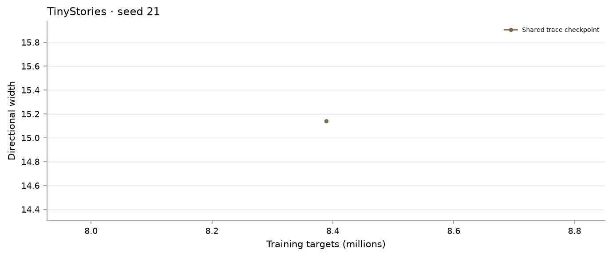

# Hybrid schedules on TinyStories

TinyStories hybrid follow-up: 0 of 48 full runs and 1 of 8 shared checkpoints complete. Geometric decision: awaiting eight paired width measurements.

[Frozen protocol and decision rule](preregistration.md) · [Interactive measurement and run selector](../../docs/index.html#curves)

Two-sided directional width is measured in the original Euclidean weight coordinates at a fixed increase of 0.1 nats per target. Each linked JSON contains all 32 rays and their brackets. A missing upper bound means that the search reached its maximum radius before crossing.

## Width observations

| Seed | Arm | Step | Width | Lower | Upper | Censored rays | Training probe NLL | Probe seconds |
| --- | --- | --- | --- | --- | --- | --- | --- | --- |
| 21 | Shared trace checkpoint | [2048](../../results/stories-branch-s21-trunk-r01/width-2048.json) | 15.14258 | 15.14160 | 15.14355 | 0 | 2.77694 | 5.28 |

## Full development and resource measurements

| Seed | Arm | Dev NLL | Accuracy | Reference RMS | Steps at zero λ₃ | Final λ₃ | Targets/s | Allocated GPU MiB | Process peak MiB |
| --- | --- | --- | --- | --- | --- | --- | --- | --- | --- |
| 21 | Shared trace checkpoint | 2.757685 | 0.43346 | 0.44853 | [2048](../../results/stories-branch-s21-trunk-r01/schedule.json) | 0 | 69,581 | 608.2 | 2,025.9 |

The completed branches reused 0 targets of optimization compared with independently training each branch from initialization. The replay permutation couples different seeds through their coefficient histories. The sign-test reference for this comparison assumes exchangeable independent pair signs; that assumption is approximate here. All raw pairs are reported for inspection.
