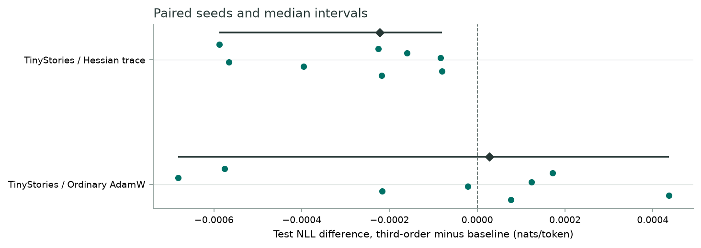

# Study summary

Recorded 86 runs, including 86 with a completed summary.

**TinyStories.** The registered test of superiority over both baselines was inconclusive. Third order had lower test NLL in 4/8 pairs against AdamW (Holm p = 0.63672) and 8/8 against Hessian trace (Holm p = 0.00781).

**Research abstracts.** Awaiting paired test results (3 of 8 full-horizon training triplets).

TinyStories hybrid follow-up: 23 of 48 full runs and 5 of 8 shared checkpoints complete. Geometric decision: awaiting eight paired width measurements. [Hybrid outcomes](hybrid/results.md)

**Snapshot at 2026-11-26T07:01:50+00:00** · 194/305 experimental milestones complete.

**Recorded activity** · Between recorded training and scoring updates.

**Next scheduled work** · Research abstracts · Third derivative · confirm seed 4 (1%).

The measured remaining-time scenarios are 21.52–22.27 machine-hours.

[Status of every planned run](planned-runs.md#current-evidence-and-remaining-runs)

[Interactive explorer](https://burnycoder.github.io/llm-training-with-penalizing-rapid-changes-of-curvature-of-its-loss-with-derivative-of-hessian/) · [Per-run ledger](experiments/experiments.md) · [Final seed sensitivity](seed-sensitivity.md) · [Preregistration](preregistration.md) · [Paper](paper.pdf)

## Development observations

**TinyStories development pilot.** At 2,097,152 training targets, the third-order run recorded 0.00004 nats per target token lower against Ordinary AdamW, 0.00024 nats per target token lower against Trace + third derivative, 0.00175 nats per target token lower against Squared Hessian norm, 0.00032 nats per target token lower against Randomized gradient signs, 0.00034 nats per target token lower against Hessian trace. These are single-seed descriptions using strengths selected on development.

**Research abstracts development pilot.** At 65,536 training targets, the third-order run recorded 0.00030 nats per target token higher against Ordinary AdamW, 0.00003 nats per target token lower against Trace + third derivative, 0.00034 nats per target token higher against Squared Hessian norm, 0.00005 nats per target token higher against Randomized gradient signs, 0.00027 nats per target token higher against Hessian trace. These are single-seed descriptions using strengths selected on development.

## Measured scores

| Stage | Phase | Method | Ratio | Tokens/run | Runs | Median dev NLL | Median dev PPL | Median test NLL | Median test PPL |
| --- | --- | --- | --- | --- | --- | --- | --- | --- | --- |
| Research abstracts | confirm | Ordinary AdamW | 0.000 | 524,288 | 3 | 3.0371 | 20.8444 | — | — |
| Research abstracts | confirm | Third derivative | 0.010 | 524,288 | 3 | 3.0371 | 20.8442 | — | — |
| Research abstracts | confirm | Hessian trace | 0.010 | 524,288 | 3 | 3.0370 | 20.8418 | — | — |
| Research abstracts | control | Initial checkpoint | 0.000 | 0 | 1 | 3.2517 | 25.8335 | — | — |
| Research abstracts | control | Unigram | 0.000 | 0 | 1 | 7.3306 | 1,526.3141 | — | — |
| Research abstracts | pilot | Ordinary AdamW | 0.000 | 65,536 | 1 | 3.1139 | 22.5097 | — | — |
| Research abstracts | pilot | Trace + third derivative | 0.010 | 65,536 | 1 | 3.1143 | 22.5172 | — | — |
| Research abstracts | pilot | Squared Hessian norm | 0.030 | 65,536 | 1 | 3.1139 | 22.5088 | — | — |
| Research abstracts | pilot | Randomized gradient signs | 0.010 | 65,536 | 1 | 3.1142 | 22.5153 | — | — |
| Research abstracts | pilot | Third derivative | 0.010 | 65,536 | 1 | 3.1142 | 22.5165 | — | — |
| Research abstracts | diagnostic | Third derivative | 0.030 | 65,536 | 1 | 3.1168 | 22.5739 | — | — |
| Research abstracts | pilot | Third derivative | 0.030 | 65,536 | 1 | 3.1149 | 22.5303 | — | — |
| Research abstracts | pilot | Third derivative | 0.100 | 65,536 | 1 | 3.1163 | 22.5630 | — | — |
| Research abstracts | pilot | Hessian trace | 0.010 | 65,536 | 1 | 3.1140 | 22.5103 | — | — |
| Research abstracts | pilot | Hessian trace | 0.030 | 65,536 | 1 | 3.1141 | 22.5136 | — | — |
| Research abstracts | pilot | Hessian trace | 0.100 | 65,536 | 1 | 3.1143 | 22.5172 | — | — |
| TinyStories | branch | Shared trace checkpoint | 0.010 | 8,388,608 | 5 | 2.7577 | 15.7633 | — | — |
| TinyStories | confirm | Ordinary AdamW | 0.000 | 16,777,216 | 8 | 2.5435 | 12.7246 | 2.5441 | 12.7324 |
| TinyStories | confirm | Third derivative | 0.010 | 16,777,216 | 8 | 2.5438 | 12.7274 | 2.5444 | 12.7350 |
| TinyStories | confirm | Hessian trace | 0.010 | 16,777,216 | 8 | 2.5442 | 12.7326 | 2.5447 | 12.7391 |
| TinyStories | control | Initial checkpoint | 0.000 | 0 | 1 | 8.3437 | 4,203.5319 | — | — |
| TinyStories | control | Unigram | 0.000 | 0 | 1 | 6.0036 | 404.8654 | — | — |
| TinyStories | hybrid | Curvature-dependent hybrid | 0.010 | 16,777,216 | 4 | 2.5461 | 12.7573 | — | — |
| TinyStories | hybrid | Always-on hybrid | 0.010 | 16,777,216 | 4 | 2.5459 | 12.7553 | — | — |
| TinyStories | hybrid | Fixed late hybrid | 0.010 | 16,777,216 | 4 | 2.5463 | 12.7596 | — | — |
| TinyStories | hybrid | Stronger trace | 0.010 | 16,777,216 | 4 | 2.5462 | 12.7585 | — | — |
| TinyStories | hybrid | Hessian trace | 0.010 | 16,777,216 | 4 | 2.5461 | 12.7573 | — | — |
| TinyStories | hybrid | Cross-seed replay | 0.010 | 16,777,216 | 3 | 2.5463 | 12.7599 | — | — |
| TinyStories | pilot | Ordinary AdamW | 0.000 | 2,097,152 | 1 | 3.8770 | 48.2780 | — | — |
| TinyStories | pilot | Trace + third derivative | 0.010 | 2,097,152 | 1 | 3.8772 | 48.2875 | — | — |
| TinyStories | pilot | Squared Hessian norm | 0.030 | 2,097,152 | 1 | 3.8787 | 48.3603 | — | — |
| TinyStories | pilot | Randomized gradient signs | 0.010 | 2,097,152 | 1 | 3.8773 | 48.2914 | — | — |
| TinyStories | pilot | Third derivative | 0.010 | 2,097,152 | 1 | 3.8769 | 48.2758 | — | — |
| TinyStories | pilot | Third derivative | 0.030 | 2,097,152 | 1 | 3.8778 | 48.3167 | — | — |
| TinyStories | pilot | Third derivative | 0.100 | 2,097,152 | 1 | 3.8827 | 48.5556 | — | — |
| TinyStories | pilot | Hessian trace | 0.010 | 2,097,152 | 1 | 3.8773 | 48.2921 | — | — |
| TinyStories | pilot | Hessian trace | 0.030 | 2,097,152 | 1 | 3.8802 | 48.4360 | — | — |
| TinyStories | pilot | Hessian trace | 0.100 | 2,097,152 | 1 | 3.8979 | 49.2988 | — | — |

## Paired evidence

### TinyStories

| Comparator | Wins | Ties | Losses | Median ΔNLL | Median interval | Coverage | Sign-test p | Holm p |
| --- | --- | --- | --- | --- | --- | --- | --- | --- |
| Ordinary AdamW | 4 | 0 | 4 | 0.00003 | [-0.00068, 0.00044] | 0.9922 | 0.63672 | 0.63672 |
| Hessian trace | 8 | 0 | 0 | -0.00022 | [-0.00059, -0.00008] | 0.9922 | 0.00391 | 0.00781 |

| Comparator | Seed | Third-order NLL | Comparator NLL | ΔNLL |
| --- | --- | --- | --- | --- |
| Ordinary AdamW | 1 | 2.54795 | 2.54787 | 0.00008 |
| Ordinary AdamW | 2 | 2.54492 | 2.54448 | 0.00044 |
| Ordinary AdamW | 3 | 2.54959 | 2.54981 | -0.00022 |
| Ordinary AdamW | 4 | 2.54379 | 2.54381 | -0.00002 |
| Ordinary AdamW | 5 | 2.54186 | 2.54174 | 0.00012 |
| Ordinary AdamW | 6 | 2.54503 | 2.54571 | -0.00068 |
| Ordinary AdamW | 7 | 2.54133 | 2.54115 | 0.00017 |
| Ordinary AdamW | 8 | 2.53893 | 2.53950 | -0.00058 |
| Hessian trace | 1 | 2.54795 | 2.54816 | -0.00022 |
| Hessian trace | 2 | 2.54492 | 2.54500 | -0.00008 |
| Hessian trace | 3 | 2.54959 | 2.54999 | -0.00040 |
| Hessian trace | 4 | 2.54379 | 2.54436 | -0.00057 |
| Hessian trace | 5 | 2.54186 | 2.54194 | -0.00008 |
| Hessian trace | 6 | 2.54503 | 2.54519 | -0.00016 |
| Hessian trace | 7 | 2.54133 | 2.54155 | -0.00023 |
| Hessian trace | 8 | 2.53893 | 2.53951 | -0.00059 |

### TinyStories at equal training time

| Seed | Common cutoff (s) | Method | Recorded checkpoint (s) | Training tokens | Dev NLL |
| --- | --- | --- | --- | --- | --- |
| 1 | 148.2 | Ordinary AdamW | 148.2 | 16,777,216 | 2.53821 |
| 1 | 148.2 | Hessian trace | 147.7 | 9,961,472 | 2.68115 |
| 1 | 148.2 | Third derivative | 146.2 | 5,767,168 | 2.95676 |
| 2 | 128.5 | Ordinary AdamW | 128.5 | 16,777,216 | 2.54429 |
| 2 | 128.5 | Hessian trace | 125.3 | 8,388,608 | 2.76035 |
| 2 | 128.5 | Third derivative | 119.9 | 3,670,016 | 3.21709 |
| 3 | 127.9 | Ordinary AdamW | 127.9 | 16,777,216 | 2.54578 |
| 3 | 127.9 | Hessian trace | 125.8 | 8,388,608 | 2.76333 |
| 3 | 127.9 | Third derivative | 117.6 | 4,718,592 | 3.06539 |
| 4 | 129.5 | Ordinary AdamW | 129.5 | 16,777,216 | 2.54476 |
| 4 | 129.5 | Hessian trace | 127.0 | 8,912,896 | 2.72832 |
| 4 | 129.5 | Third derivative | 125.4 | 5,242,880 | 2.98916 |
| 5 | 127.9 | Ordinary AdamW | 127.9 | 16,777,216 | 2.55194 |
| 5 | 127.9 | Hessian trace | 124.2 | 8,912,896 | 2.73483 |
| 5 | 127.9 | Third derivative | 123.6 | 5,242,880 | 2.99045 |
| 6 | 127.0 | Ordinary AdamW | 127.0 | 16,777,216 | 2.54574 |
| 6 | 127.0 | Hessian trace | 123.0 | 8,912,896 | 2.72481 |
| 6 | 127.0 | Third derivative | 125.5 | 5,242,880 | 2.99234 |
| 7 | 127.3 | Ordinary AdamW | 127.3 | 16,777,216 | 2.54156 |
| 7 | 127.3 | Hessian trace | 123.8 | 8,912,896 | 2.72243 |
| 7 | 127.3 | Third derivative | 116.3 | 4,718,592 | 3.06669 |
| 8 | 127.8 | Ordinary AdamW | 127.8 | 16,777,216 | 2.54577 |
| 8 | 127.8 | Hessian trace | 121.2 | 8,388,608 | 2.74887 |
| 8 | 127.8 | Third derivative | 120.9 | 4,718,592 | 3.04410 |

### Research abstracts at equal training time

| Seed | Common cutoff (s) | Method | Recorded checkpoint (s) | Training tokens | Dev NLL |
| --- | --- | --- | --- | --- | --- |
| 1 | 347.9 | Ordinary AdamW | 347.9 | 524,288 | 3.00554 |
| 1 | 347.9 | Hessian trace | 321.6 | 98,304 | 3.04789 |
| 1 | 347.9 | Third derivative | 235.9 | 24,576 | 3.16336 |
| 2 | 329.6 | Ordinary AdamW | 329.6 | 524,288 | 3.00597 |
| 2 | 329.6 | Hessian trace | 228.6 | 65,536 | 3.07202 |
| 2 | 329.6 | Third derivative | 95.6 | 32,768 | 3.13520 |
| 3 | 318.3 | Ordinary AdamW | 318.3 | 524,288 | 3.00681 |
| 3 | 318.3 | Hessian trace | 308.4 | 98,304 | 3.04877 |
| 3 | 318.3 | Third derivative | 212.4 | 32,768 | 3.13038 |

### Research abstracts after subtracting host derivative calls

This supplementary clock excludes the measured host probe calls and their transfers. The registered comparison above counts elapsed time with one GPU reserved.

| Seed | Cutoff (s) | Method | Checkpoint (s) | Training tokens | Dev NLL |
| --- | --- | --- | --- | --- | --- |
| 1 | 347.9 | Ordinary AdamW | 347.9 | 524,288 | 3.00554 |
| 1 | 347.9 | Hessian trace | 325.7 | 458,752 | 3.00555 |
| 1 | 347.9 | Third derivative | 321.2 | 262,144 | 3.01897 |
| 2 | 329.6 | Ordinary AdamW | 329.6 | 524,288 | 3.00597 |
| 2 | 329.6 | Hessian trace | 306.4 | 393,216 | 3.00860 |
| 2 | 329.6 | Third derivative | 323.0 | 262,144 | 3.01618 |
| 3 | 318.3 | Ordinary AdamW | 318.3 | 524,288 | 3.00681 |
| 3 | 318.3 | Hessian trace | 311.5 | 491,520 | 3.00756 |
| 3 | 318.3 | Third derivative | 287.6 | 229,376 | 3.01960 |

