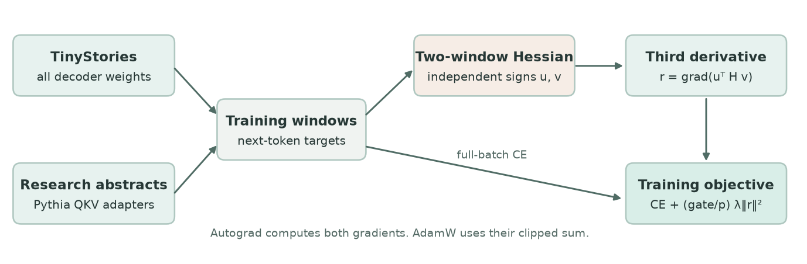
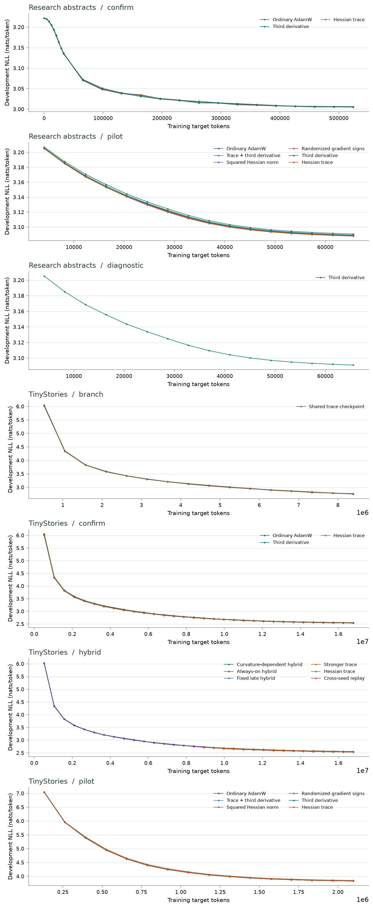

# Study summary

Recorded 13 runs, including 13 with a completed summary.

**TinyStories.** Awaiting paired test results (0 of 8 full-horizon training triplets).

**Research abstracts.** Awaiting paired test results (0 of 8 full-horizon training triplets).

[Interactive explorer](https://burnycoder.github.io/llm-training-with-penalizing-rapid-changes-of-curvature-of-its-loss/) · [Per-run ledger](experiments/experiments.md) · [Preregistration](preregistration.md) · [Paper](paper.pdf)

## Development observations

**TinyStories development pilot.** At 2,097,152 training targets, the third-order run recorded 0.00004 nats per target token lower against Ordinary AdamW, 0.00024 nats per target token lower against Trace + third derivative, 0.00175 nats per target token lower against Squared Hessian norm, 0.00032 nats per target token lower against Randomized gradient signs, 0.00034 nats per target token lower against Hessian trace. These are single-seed descriptions using selected on development.

## Measured scores

| Stage | Phase | Method | Ratio | Tokens/run | Runs | Median dev NLL | Median test NLL |
| --- | --- | --- | --- | --- | --- | --- | --- |
| Research abstracts | pilot | Third derivative | 0.030 | 65,536 | 1 | 3.1168 | — |
| TinyStories | control | Initial checkpoint | 0.000 | 0 | 1 | 8.3437 | — |
| TinyStories | control | Unigram | 0.000 | 0 | 1 | 6.0036 | — |
| TinyStories | pilot | Ordinary AdamW | 0.000 | 2,097,152 | 1 | 3.8770 | — |
| TinyStories | pilot | Trace + third derivative | 0.010 | 2,097,152 | 1 | 3.8772 | — |
| TinyStories | pilot | Squared Hessian norm | 0.030 | 2,097,152 | 1 | 3.8787 | — |
| TinyStories | pilot | Randomized gradient signs | 0.010 | 2,097,152 | 1 | 3.8773 | — |
| TinyStories | pilot | Third derivative | 0.010 | 2,097,152 | 1 | 3.8769 | — |
| TinyStories | pilot | Third derivative | 0.030 | 2,097,152 | 1 | 3.8778 | — |
| TinyStories | pilot | Third derivative | 0.100 | 2,097,152 | 1 | 3.8827 | — |
| TinyStories | pilot | Hessian trace | 0.010 | 2,097,152 | 1 | 3.8773 | — |
| TinyStories | pilot | Hessian trace | 0.030 | 2,097,152 | 1 | 3.8802 | — |
| TinyStories | pilot | Hessian trace | 0.100 | 2,097,152 | 1 | 3.8979 | — |

